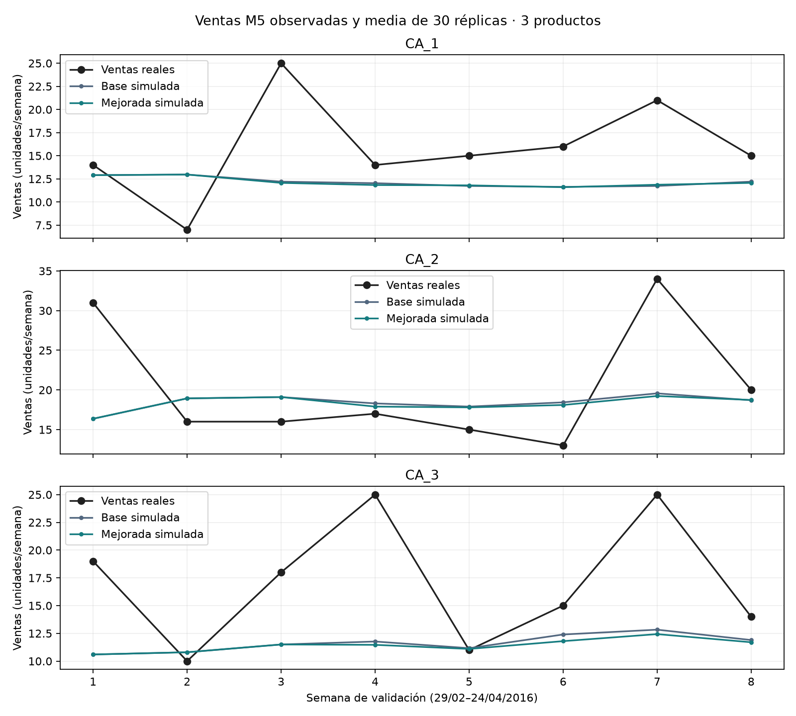
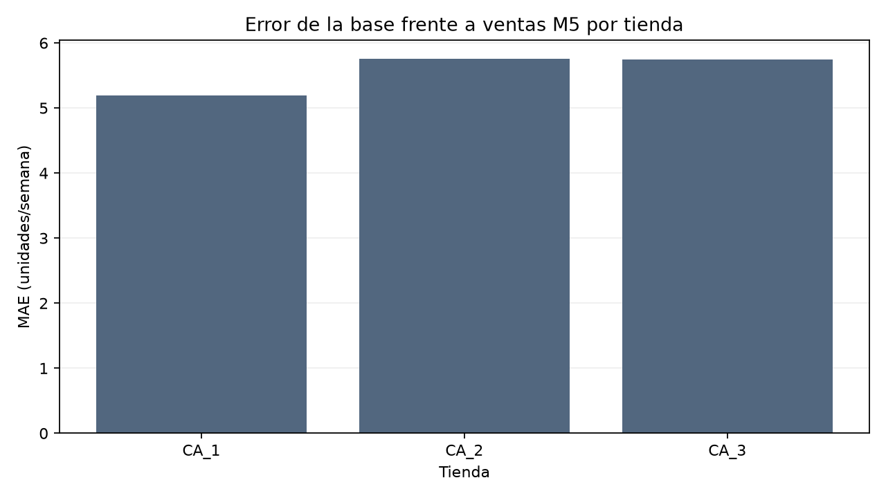
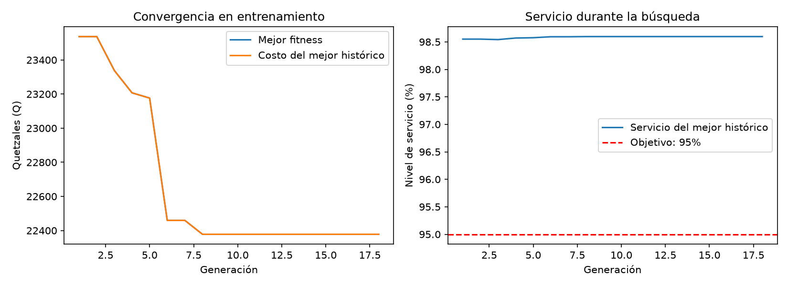
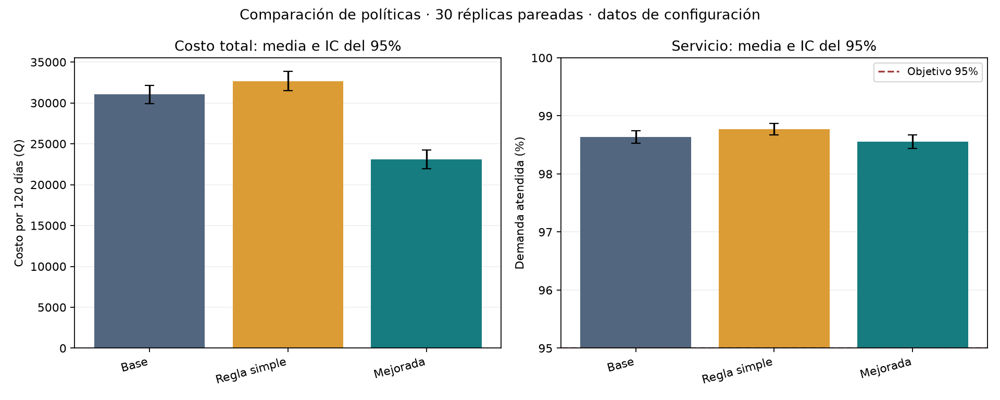
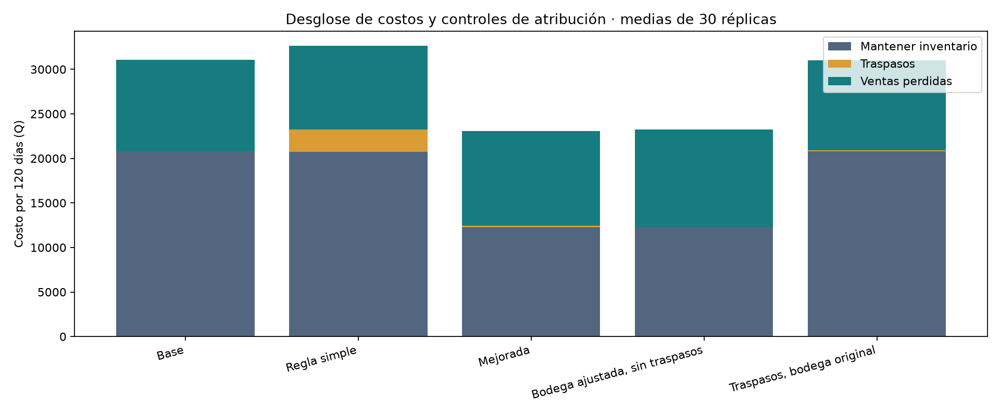
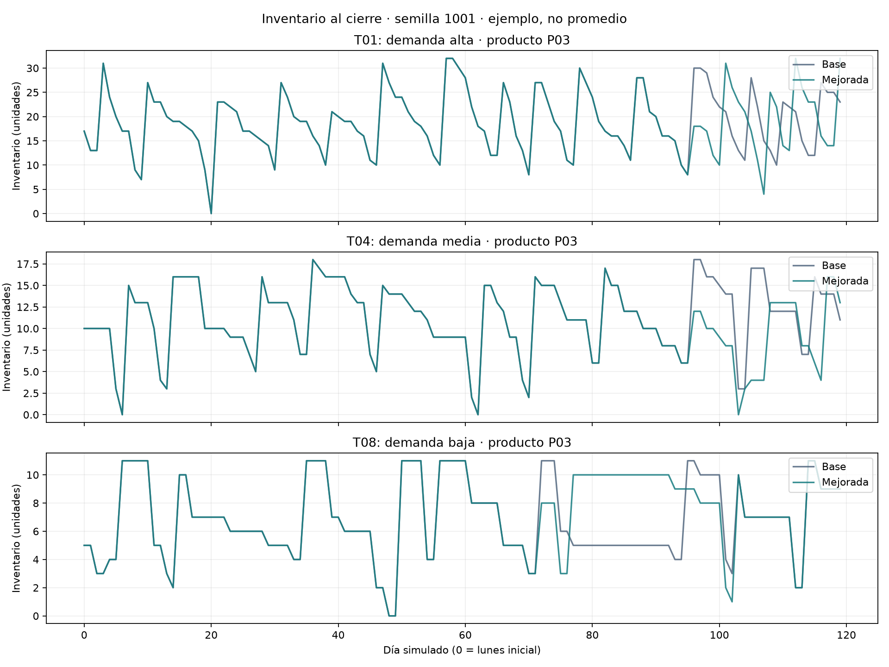
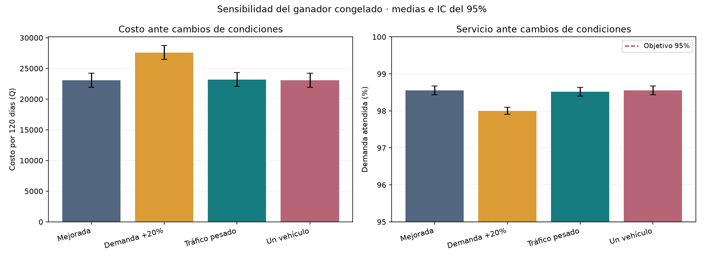

# Proyecto 2: traspasos de inventario entre tiendas

## Informe técnico integrado

**Universidad del Valle de Guatemala**  
**Curso:** CC3074 — Modelización y Simulación  
**Integrantes y carnés:** pendiente de completar por el equipo.  
**Docente y fecha de entrega:** pendiente de completar por el equipo.

**Estado del documento:** borrador integrado. Contiene el problema, la
investigación, la formulación, la implementación, la optimización y el estudio
experimental sintético con comparación, atribución y sensibilidad. Incluye un
contraste parcial con ventas públicas M5; la validación integral de la cadena
de referencia sigue pendiente. Este archivo es el documento maestro del informe.

## Resumen

Se desarrolló un modelo de simulación diaria de inventario para una cadena de
tiendas abastecida desde una bodega central. El modelo representa demanda
aleatoria, ventas perdidas, reposición mediante reglas (s, S) y traspasos entre
tiendas. La mejora propuesta ajusta los parámetros de una política de traspasos
mediante un algoritmo genético con reparación de restricciones, evaluación por
réplicas y reevaluación de candidatos. Un flujo de costo mínimo selecciona la
carga de cada viaje, mientras una heurística voraz selecciona las rutas.

La ejecución disponible utiliza datos sintéticos de 10 tiendas, una bodega,
3 productos y un horizonte de 120 días. El genético, con 30 individuos y hasta
50 generaciones, terminó en la generación 18 por estancamiento. El ganador
alcanzó un costo promedio de Q23,074.24 y un nivel de servicio promedio de
98.56% en 30 réplicas con semillas independientes de las usadas para seleccionarlo.

Un estudio posterior, sin reentrenamiento, comparó ocho condiciones con 30
réplicas cada una. Frente a la base, la política mejorada redujo el costo
promedio en 25.68%, pero aumentó las unidades perdidas en 6.03% y disminuyó
el servicio en 0.0816 puntos porcentuales. La prueba pareada confirmó la
reducción de costo; los controles mostraron que el ahorro proviene principalmente
del ajuste de bodega, sin evidencia estadística suficiente de ahorro incremental
por los traspasos. Con demanda +20% y existencias de referencia constantes,
el costo aumentó 19.54% respecto a la mejorada nominal. Estos hallazgos
corresponden al sistema sintético; el contraste parcial M5 y sus limitaciones
se presentan en la sección 6. Validar una cadena concreta requiere más datos.

**Palabras clave:** inventario, traspasos laterales, simulación, algoritmo
genético, restricciones, flujo de costo mínimo.

## Contenido

1. Problema y objetivos.
2. Investigación de la técnica adicional.
3. Formulación del modelo.
4. Implementación de la mejora.
5. Diseño experimental y verificación.
6. Comparación con la vida real.
7. Resultados experimentales.
8. Conclusiones y limitaciones.
9. Referencias.
10. Anexo de reproducibilidad y responsabilidades.

## 1. Problema y objetivos

### 1.1 Contexto y planteamiento

La demanda de un producto no es uniforme entre los puntos de venta de una
cadena. Una tienda puede agotar sus existencias mientras otra conserva unidades
que tardarán en venderse. Si cada tienda depende exclusivamente de reposiciones
desde bodega, el inventario disponible en otros establecimientos no se aprovecha
para responder a esos faltantes.

Los traspasos laterales trasladan unidades entre tiendas del mismo nivel de la
red. Pueden evitar ventas perdidas, pero introducen costos de viaje y el riesgo
de dejar sin existencias al donante. Por ello, no basta con mover productos de
una tienda con más inventario a otra con menos: debe evaluarse si llegarán a
tiempo y si el beneficio esperado compensa el costo y el riesgo.

El proyecto estudia esta decisión mediante simulación y optimización. La
referencia empresarial prevista es una cadena cuyos datos aportaría el equipo;
en la versión actual solo se dispone del contrato sintético de arranque. No
se atribuyen a una empresa real los parámetros ni resultados de ese contrato.

### 1.2 Pregunta de investigación

¿Cuánto se reducen el costo total y las ventas perdidas de la cadena si los
traspasos entre tiendas se deciden con una política optimizada, en lugar de
depender solo de la reposición desde bodega?

### 1.3 Objetivo general

Evaluar, mediante simulación, el efecto de una política de traspasos entre
tiendas cuyos parámetros se ajustan con un algoritmo genético sobre el costo
total y el nivel de servicio de una cadena con bodega central.

### 1.4 Objetivos específicos

1. Representar la dinámica diaria de inventario, demanda, ventas, faltantes y
   reposición de tiendas y bodega.
2. Formular un indicador económico que relacione el beneficio de atender
   demanda adicional con el costo del traslado y el riesgo para el donante.
3. Implementar políticas de traspasos que respeten exhibición, exceso disponible,
   capacidad de transporte, tránsito y conservación de unidades.
4. Ajustar los parámetros de la política mediante un genético con restricciones
   y evaluaciones replicadas bajo demanda común.
5. Comparar el escenario base, una regla simple y la política ajustada, y evaluar
   su sensibilidad con estadística sobre réplicas pareadas.
6. Contrastar el modelo base con datos reales antes de interpretar la mejora
   como una recomendación operativa.

El objetivo 5 se evaluó en el contrato sintético. El objetivo 6 permanece
parcialmente abordado con datos públicos M5; falta validar inventarios y la
operación de la cadena concreta.

### 1.5 Alcance

Se incluyen una bodega, múltiples tiendas y productos, demanda semanalmente
estacional, pronóstico simple, reposición (s, S), transporte e inventario en
tránsito, costos y ventas perdidas. La ejecución disponible considera 10
tiendas, 3 productos y 120 días, dentro del tamaño sugerido en el plan.

No se modelan precios variables, sustitución entre productos, pedidos de
clientes pendientes, retornos de vehículos ni rutas con varias paradas. Cada
vehículo puede hacer como máximo un viaje directo por día. La reposición sigue
una regla (s, S); sus parámetros de bodega forman parte del cromosoma, por lo
que su ajuste debe distinguirse del efecto exclusivo de los traspasos.

## 2. Investigación de la técnica adicional

### 2.1 Selección de un algoritmo genético

Los parámetros de una política de inventario interactúan de forma no lineal:
una mayor reserva protege al donante, pero reduce la cantidad transferible;
un umbral económico alto evita viajes poco rentables, pero puede dejar demanda
sin atender. Las evaluaciones contienen ruido porque la demanda es aleatoria.

Un algoritmo genético permite explorar una representación mixta de enteros y
reales utilizando el simulador como evaluador, sin requerir derivadas del costo.
Eiben y Smith (2015) presentan la representación, selección, recombinación y
mutación como componentes configurables de los algoritmos evolutivos. En este
proyecto el cromosoma describe una política reutilizable y no una lista de
todos los movimientos diarios, lo que limita la dimensión de búsqueda.

### 2.2 Manejo de restricciones

Deb (2000) estudia el manejo de restricciones en algoritmos genéticos y la
distinción entre factibilidad y calidad. Nuestra implementación combina
reparación y penalización; no implementa las reglas específicas de selección
por factibilidad propuestas por ese autor.

Se distinguen dos niveles:

- **Política válida:** genes dentro de sus rangos, valores enteros donde
  corresponde, S de bodega mayor o igual que s y horizontes compatibles con
  el pronóstico.
- **Acciones válidas:** envíos limitados por exceso y capacidad, reserva de
  exhibición, inventario no negativo y conservación durante el tránsito.

El objetivo de 95% de servicio se trata como una restricción blanda sobre el
promedio de réplicas: incumplirlo aumenta el fitness, pero no invalida
automáticamente al candidato ni garantiza 95% por tienda o producto.

### 2.3 Optimización mediante simulación y evaluación ruidosa

Amaran et al. (2016) describen la optimización mediante simulación como la
búsqueda de decisiones cuyo desempeño se obtiene evaluando un modelo. Aquí
la función objetivo se estima con réplicas y no se conoce de forma cerrada.

Para un candidato $\theta$, se minimiza:

$$
\widehat F(\theta)=\frac{1}{R}\sum_{r=1}^{R}C_r(\theta)
+\lambda\max\left(0,0.95-\frac{1}{R}\sum_{r=1}^{R}NS_r(\theta)\right),
\qquad \lambda=100000.
$$

$C_r$ se expresa en quetzales y $NS_r$ como fracción entre cero y uno.
Un déficit de 0.01 en servicio promedio agrega Q1,000 al fitness. El valor de
la penalización es un supuesto del equipo, no una calibración económica real.

Se emplean las mismas semillas de demanda para comparar candidatos durante
el entrenamiento. Los cinco mejores genotipos distintos se reevalúan con
semillas adicionales y el ganador se evalúa con un tercer conjunto independiente.
Esto reduce el riesgo de seleccionar una política por una realización favorable.

### 2.4 Extensión y fundamento bibliográfico

La extensión del genético visto en clase combina reparación, evaluación con
réplicas y números aleatorios comunes, reevaluación de finalistas e integración
con el simulador y el flujo de costo mínimo. Según el plan, el equipo debe
confirmar con el docente su clasificación como técnica adicional válida.

| Fuente | Aporte al enfoque |
| --- | --- |
| Eiben y Smith (2015) | Representación, operadores y administración de población |
| Deb (2000) | Fundamento del manejo de restricciones y factibilidad |
| Amaran et al. (2016) | Marco de optimización con evaluaciones de simulación |

Estas referencias sustentan el enfoque general, no demuestran que la población,
rangos o penalización elegidos sean óptimos para esta aplicación.

## 3. Formulación del modelo

### 3.1 Conjuntos, estados y decisiones

Se consideran tiendas $i,j\in\{1,\ldots,N\}$, productos
$k\in\{1,\ldots,K\}$, una bodega $w$ y días
$t\in\{0,\ldots,T-1\}$. Cada tienda pertenece a una clase de demanda
$g(i)\in\{\text{alta},\text{media},\text{baja}\}$.

| Símbolo | Descripción | Unidad |
| --- | --- | --- |
| $I_{ik,t}$ | Inventario disponible en tienda | Unidades |
| $W_{k,t}$ | Inventario disponible en bodega | Unidades |
| $A_{ik,t}$ | Llegadas programadas a tiendas | Unidades |
| $A^w_{k,t}$ | Llegadas programadas a bodega | Unidades |
| $D_{ik,t}$ | Demanda real de una réplica | Unidades/día |
| $\widehat\mu_{ik,t+\ell}$ | Pronóstico de demanda futura | Unidades/día |
| $Y_{ik,t}$ | Unidades vendidas | Unidades/día |
| $P_{ik,t}$ | Unidades de demanda perdida | Unidades/día |
| $q_{ijk,t}$ | Cantidad enviada entre tiendas | Unidades |
| $d_{ij}$ | Distancia vial estimada | km |
| $m_k$ | Margen no obtenido por unidad perdida | Q/unidad |

La política observa inventario, llegadas comprometidas, pérdidas acumuladas y
pronóstico después de las ventas del día. No recibe las realizaciones futuras
de demanda utilizadas por el motor.

### 3.2 Datos, parámetros y procedencia

Los CSV sintéticos contienen 10 tiendas y 210 registros de demanda: una fila
por tienda, producto y día semanal. La clase de tienda se declara antes de
simular. El generador usa medias base de 6, 3 y 1.5 unidades/día por producto,
factores de clase 1.5, 1 y 0.6, heterogeneidad multiplicativa lognormal y un
perfil semanal normalizado. Las dispersiones por clase son 2, 4 y 6.

| Parámetro | Valor de referencia | Origen y función |
| --- | --- | --- |
| Horizonte | 120 días | Supuesto dentro del tamaño previsto |
| Tiendas, bodega y productos | 10, 1 y 3 | Diseño del contrato sintético |
| Márgenes P01, P02 y P03 | Q12, Q35 y Q90/unidad | Estimados; valoran ventas perdidas |
| Mantenimiento | Q0.08/unidad·día | Estimado; penaliza inventario al cierre |
| Viaje fijo | Q60/viaje | Estimado; activa un traslado |
| Costo variable | Q4/km | Estimado; depende de distancia |
| Vehículos | 2 | Supuesto; un viaje por vehículo y día |
| Capacidad por vehículo | 150 unidades | Supuesto; compartida por productos |
| Velocidad | 30 km/h | Estimada, antes del tráfico |
| Factor vial | 1.3 | Estimado; multiplica Haversine |
| Factores de tráfico | 1.0–1.9 | Estimados por franja de salida |
| Mínimo de exhibición | 2 unidades/producto | Supuesto; reserva del donante al enviar |
| Inventario inicial de tienda | 7 días de demanda media | Supuesto, redondeado a unidades |
| Inventario inicial de bodega | 21 días de demanda media de la cadena | Supuesto, redondeado a unidades |
| Entrega de bodega a tienda | 2 días | Estimada |
| Seguridad y objetivo de reposición en tienda | 3 y 12 días | Supuestos de la regla fija |
| Entrega de proveedor a bodega | 7 días | Estimada |
| s y S de bodega, base | 10 y 30 días | Supuestos; sustituibles por el candidato |
| Ventana de pronóstico | 4 semanas | Supuesto |
| Horizonte de pronóstico | 14 días | Supuesto; limita H + SS |
| Descuento diario $\delta$ | 0.98 | Supuesto de valoración temporal |

Las coordenadas son ficticias alrededor de (14.60, −90.52). La procedencia y
la semilla de generación se conservan en
[`procedencia.json`](../../data/synthetic/procedencia.json). Ninguna magnitud
de esta tabla debe citarse como medición real de una empresa.

### 3.3 Demanda aleatoria y pronóstico

La demanda usa una media por tienda, producto y día semanal. Si la dispersión
varianza/media es uno, se utiliza Poisson; si es mayor que uno, se usa binomial
negativa parametrizada para obtener la media y dispersión especificadas:

$$
E[D_{ik,t}]=\mu_{ik,t},\qquad
\operatorname{Var}(D_{ik,t})=\phi_{ik,t}\mu_{ik,t}.
$$

El motor pregenera la demanda de toda la réplica a partir de la semilla.
Con igual configuración de demanda y semilla, la secuencia no cambia al
modificar la política de traspasos.

El pronóstico promedia las ventas observadas del mismo día semanal en las
últimas cuatro semanas. Las semanas todavía no observadas se completan con
la media previa del archivo de entrada. Se producen 14 días de pronóstico.
Se utilizan ventas observadas, no demanda futura; cuando hubo agotamientos,
esta serie puede subestimar la demanda latente.

### 3.4 Dinámica diaria y reposición

El orden diario es el siguiente:

```text
para cada día:
    recibir llegadas programadas a tiendas y bodega
    atender demanda con el inventario disponible
    registrar ventas perdidas
    construir pronóstico y decidir traspasos
    descontar envíos del donante y programar su llegada
    aplicar reposición (s, S) de tiendas desde bodega
    aplicar compras (s, S) de bodega al proveedor
    registrar inventario de cierre, costos y balances
```

Después de recibir llegadas:

$$
Y_{ik,t}=\min(I_{ik,t},D_{ik,t}),\qquad
P_{ik,t}=D_{ik,t}-Y_{ik,t}.
$$

Las pérdidas no se acumulan como pedidos pendientes de clientes. Los envíos
se descuentan del inventario al despachar y se reciben cuando termina el tránsito.

La reposición utiliza la posición de inventario: existencias más unidades
ya en camino. Si la posición es menor o igual que s, se pide hasta S:

$$
Q=\begin{cases}
\max(0,\lceil S-\text{posición}\rceil),&\text{posición}\leq s,\\
0,&\text{en otro caso}.
\end{cases}
$$

Para tiendas, s equivale a demanda media diaria por tiempo de entrega más
seguridad, y S a demanda media diaria por días objetivo. Si la bodega no
alcanza, reparte proporcionalmente y redondea hacia abajo. Para la bodega se
usa la demanda media diaria agregada de la cadena y sus parámetros en días.
La regla se mantiene; el genético puede cambiar s y S de bodega.

Para aislar el aumento de demanda en la sensibilidad se incorporó una opción
de referencia de inventario: la demanda real y la media previa del pronóstico
pueden multiplicarse por 1.2 sin escalar las existencias iniciales ni los
niveles (s, S). Sin esta opción se conserva el comportamiento original de la
optimización, donde esos niveles siguen la escala de demanda configurada.

### 3.5 Distancias, tráfico y tránsito

La distancia entre coordenadas se estima con Haversine, usando un radio
terrestre de 6371.0088 km, y se multiplica por el factor vial 1.3. No es una
distancia calculada sobre una red real de carreteras.

$$
\tau_{ij}(h_d)=\frac{d_{ij}}{v}\,f(h_d),\qquad
L_{ij}=\max\left(1,\left\lceil\frac{h_d+\tau_{ij}(h_d)}{24}\right\rceil\right).
$$

$\tau$ se expresa en horas y $L$ en días. Se aplica el factor de la
franja de salida; no se integra el cambio de tráfico durante el viaje.
El motor no admite que un traspaso llegue en el día del despacho. La distancia
y el costo corresponden a la ida, sin recorrido de retorno modelado.

### 3.6 Cobertura, exceso e indicador económico

La cobertura compara inventario con demanda media prevista. Demanda cero
implica cobertura infinita. Para un donante de clase g, el exceso transferible es:

$$
\operatorname{cob}_{ik}=\frac{I_{ik}}{\bar\mu_{ik}},\qquad
e_{ik}=\max\left(0,\left\lfloor I_{ik}-
\max\{I_{\min},\bar\mu_{ik}(H_g+SS_g)\}\right\rfloor\right).
$$

La media $\bar\mu$ se calcula sobre el horizonte de esa tienda. Las
llegadas pendientes ayudan a estimar faltantes y ventas futuras; no se cuentan
como unidades disponibles hoy para enviar.

Para un viaje consolidado de i a j con cantidades $\mathbf q$, el valor
de decisión se aproxima como:

$$
V_{ij}(\mathbf q)=\sum_k m_k\left[
\sum_{\ell=1}^{H_{g(j)}}\Delta\widehat Y_{jk,\ell}(\mathbf q)\delta^{\ell}
-\sum_{\ell=1}^{\lceil H_{g(i)}+SS_{g(i)}\rceil}
\Delta\widehat P_{ik,\ell}(\mathbf q)\right]
-c_{ij}-p_T\max(0,f(h_d)-1)c_{ij},
$$

$$
c_{ij}=c_f+c_{km}d_{ij}.
$$

Las ventas extra y pérdidas adicionales se obtienen comparando proyecciones
de inventario con y sin envío, usando el pronóstico como demanda esperada.
No se integra toda la distribución de demanda. Se consideran llegadas
comprometidas y una estimación del despacho de bodega de hoy, limitada por su
stock; no se anticipan todas las reposiciones futuras.

El costo fijo se resta una vez por viaje, aunque consolide productos. La
penalización por tráfico influye en la decisión, pero no es un gasto físico
añadido al costo total. La política económica acepta un viaje solo si
$V_{ij}>u_V$; si una reposición cubre las ventas antes de que llegue el
traspaso, el beneficio adicional disminuye o desaparece.

### 3.7 Costos, métricas y restricciones

El costo físico por réplica es:

$$
C=C_I+C_T+C_P,
$$

$$
C_I=h\sum_{t=0}^{T-1}\left(\sum_{i,k}I^{\mathrm{cierre}}_{ik,t}
+\sum_k W^{\mathrm{cierre}}_{k,t}\right),\qquad
C_T=\sum_{\text{viajes}}(c_f+c_{km}d_{ij}),\qquad
C_P=\sum_{t,i,k}m_kP_{ik,t}.
$$

El mantenimiento se cobra al stock de cierre en tiendas y bodega, no a las
unidades en tránsito. El costo de ventas perdidas representa margen no obtenido,
no el precio completo de venta. La implementación no incorpora costos de compra
ni fletes de proveedor o bodega dentro del costo de traspasos laterales.

$$
NS=\frac{\sum_{t,i,k}Y_{ik,t}}{\sum_{t,i,k}D_{ik,t}}.
$$

Si la demanda total es cero, se define servicio igual a uno. Se registran
también unidades perdidas, viajes consolidados y kilómetros recorridos.

Los envíos deben cumplir:

- Cantidades enteras positivas, tiendas distintas y llegada posterior al despacho.
- Inventario disponible no negativo y donante por encima del mínimo de exhibición.
- Envíos agregados de cada donante/producto no mayores que su exceso disponible.
- Un viaje por vehículo y día, con capacidad compartida entre productos.
- Conservación de unidades, incluyendo inventario que sigue en tránsito al terminar.

## 4. Implementación de la mejora

### 4.1 Arquitectura y políticas

```text
CSV + configuración
    → carga y validación
    → motor diario + demanda y pronóstico
    → política de traspasos
        → transporte y valoración económica
        → selección de carga por flujo y de rutas por heurística
    → métricas por réplica
    → evaluación y operadores del genético
    → ganador, historial y evaluación independiente
```

El escenario base no ejecuta traspasos. La regla simple usa umbrales fijos
de cobertura y reserva, y prioriza tiendas y productos por índice sin buscar
rentabilidad. Puede ejecutar viajes con V negativo, pero respeta las
restricciones físicas y evita cubrir dos veces faltantes ya atendidos por
envíos planificados.

La política económica calcula curvas de beneficio marginal por producto para
cada ruta. Un flujo de costo mínimo selecciona unidades con capacidad común
y una salida de costo cero para dejar capacidad sin usar. Después se resta
el costo real del viaje y se elige la ruta de mayor V aceptable. Se actualizan
inventario y llegadas antes de decidir el siguiente vehículo.

El flujo optimiza la carga de cada ruta; la selección de rutas es voraz y no
garantiza el óptimo global con cargos fijos. Los costos marginales se redondean
a microquetzales para el flujo; V se comprueba sin ese redondeo. Las líneas
de productos comparten un identificador de viaje y solo una contiene el costo
y los kilómetros, evitando duplicaciones en las métricas.

### 4.2 Cromosoma de 11 genes

$$
\theta=(s_w,S_w,H_a,SS_a,H_m,SS_m,H_b,SS_b,u_V,p_T,h_d).
$$

| Genes | Tipo y cantidad | Rango | Función |
| --- | --- | --- | --- |
| `bodega_s_dias` | Un entero | 5–20 | Umbral de bodega en días |
| `bodega_S_dias` | Un entero | 15–45 | Objetivo de bodega en días |
| `horizonte_dias_alta/media/baja` | Tres enteros | 1–7 | H por clase |
| `seguridad_dias_alta/media/baja` | Tres enteros | 0–7 | SS por clase |
| `umbral_valor_q` | Un real | 0–200 | Umbral por viaje, Q |
| `peso_trafico` | Un real | 0–2 | Penalización adicional de tráfico |
| `hora_despacho` | Un entero | 0–23 | Hora de salida |

La ampliación de siete genes globales a once permite diferenciar reservas
y horizontes por clase, conforme al rango de 10–20 genes previsto en el plan.
Los límites son supuestos de diseño y requieren análisis de sensibilidad.
La reparación acota los genes, redondea enteros y garantiza S ≥ s y
H + SS compatible con el horizonte de pronóstico configurado.

### 4.3 Operadores y control del algoritmo

| Componente | Configuración utilizada |
| --- | --- |
| Población | 30 individuos |
| Máximo de generaciones | 50 |
| Selección | Torneo de 3 |
| Cruce | Uniforme, probabilidad 0.85 |
| Mutación | Probabilidad 0.10 por hijo; modifica un gen elegido al azar |
| Perturbación | Gaussiana con σ igual a 10% del rango del gen |
| Elitismo | 2 individuos |
| Parada por estancamiento | 10 generaciones consecutivas sin mejora |
| Finalistas | Hasta 5 genotipos distintos |

Población y máximo de generaciones utilizan el extremo inferior del presupuesto
del plan. No se presentan como valores calibrados u óptimos. Cada hijo se
repara. Los genotipos repetidos reutilizan su evaluación dentro de la corrida,
porque configuración y semillas permanecen fijas.

### 4.4 Réplicas, integración y reproducibilidad

| Generador o etapa | Semilla o conjunto | Uso |
| --- | --- | --- |
| Datos sintéticos | 20261109 | Generador independiente de entradas |
| Operadores del genético | 20261109 | Instancia local `random.Random` |
| Entrenamiento | 1–10 | Fitness bajo demanda común |
| Reevaluación | 11–40 | Elección entre finalistas |
| Evaluación final | 1001–1030 | Medición posterior a la selección |

Los conjuntos de demanda son disjuntos. El final no participa en selección,
mutación, criterio de parada ni elección del ganador. El proceso principal
administra los operadores; los trabajadores evalúan candidatos con semillas
fijas y devuelven los resultados en orden, conservando la reproducibilidad.

El adaptador conecta el genético con el motor y la política económica. La
corrida conserva ganador, historial por generación, métricas por réplica,
gráfica y manifiesto con versiones, configuración y huellas SHA-256 de entradas
y código. Una instantánea de progreso no equivale a una reanudación completa
del algoritmo: no guarda el estado completo de su generador.

## 5. Diseño experimental y verificación

### 5.1 Verificación ya realizada

La última verificación registrada del proyecto obtuvo **131 pruebas aprobadas**.
La evidencia disponible cubre:

- Conservación en tiendas, bodega y sistema, incluyendo tránsito final.
- Demanda cero, inventario abundante y ausencia de inventario negativo.
- Semilla común independiente de la política.
- Distancias, tráfico, costo a distancia cero y consolidación de productos.
- Capacidad por viaje, exceso agregado y mínimo de exhibición.
- Selección de carga comparada con enumeración exhaustiva en un caso pequeño.
- Efecto real de parámetros por tipo, reparación y operadores del genético.
- Igualdad entre ejecución secuencial y paralela y aislamiento del RNG global.
- Emparejamiento por semilla, intervalos con desviación muestral y ajuste de Holm.
- Manejo de diferencias nulas y rechazo de semillas duplicadas o no emparejadas.
- Construcción de escenarios sin modificar el ganador y ejecución integral de
  un diseño pequeño con archivos estadísticos y gráficas.

La corrida comparativa verificó conservación y existencias no negativas en
sus 240 réplicas, igualdad de demanda nominal por semilla, constancia del
inventario inicial y consistencia de costos y servicio. Su condición mejorada
coincidió con las 30 réplicas finales guardadas de la optimización. Las
huellas de entradas y código se registran en el manifiesto experimental.
Esto es verificación interna y reproducibilidad; no demuestra correspondencia
del modelo con una cadena real.

### 5.2 Diseño comparativo ejecutado

El diseño se fijó en [`experiments/diseno.yaml`](../../experiments/diseno.yaml)
antes de observar las comparaciones. Se mantuvieron 10 tiendas, 3 productos,
120 días y el ganador previamente seleccionado, sin volver a entrenar ni
ajustar sus parámetros con los resultados del experimento.

| Condición | Política y cambio | Propósito |
| --- | --- | --- |
| Base | Sin traspasos, bodega s = 10 y S = 30 días | Referencia |
| Regla simple | H = 3, SS = 2, bodega original | Evaluar movimientos sin optimización económica |
| Mejorada | Ganador completo, bodega s = 6 y S = 15 días | Evaluar la política ajustada |
| Bodega ajustada | s = 6 y S = 15, sin traspasos | Separar el efecto de la reposición |
| Traspasos con bodega original | Genes de traspasos ganadores, s = 10 y S = 30 | Evaluar traspasos manteniendo bodega original |
| Demanda +20% | Mejorada con demanda y media previa ×1.2 | Estrés con existencias y niveles de reposición constantes |
| Tráfico pesado | Mejorada con factor de tráfico 2 en todas las franjas | Sensibilidad de transporte |
| Un vehículo | Mejorada con un viaje diario en lugar de dos | Sensibilidad de capacidad |

Se ejecutaron **30 réplicas por condición, 240 en total**, usando semillas
1001–1030. Cada réplica completa es la unidad estadística: los 120 días no se
tratan como 120 observaciones independientes. Para las siete condiciones con
igual distribución de demanda se comprobó que la trayectoria de demanda fuera
exactamente la misma por semilla mediante SHA-256. El cambio de distribución
en demanda +20% conserva el identificador de semilla, pero no una trayectoria
idéntica ni necesariamente un aumento punto a punto.

La tabla [`resultados.csv`](../../results/experimentos/semillas_1001_1030/resultados.csv)
contiene una fila por condición y semilla y las ocho métricas del motor.
El servicio se guarda como fracción y se transforma a porcentaje al presentar.
Los controles de bodega permiten distinguir el efecto conjunto de la política
del efecto incremental de introducir los traspasos con reposición constante.

### 5.3 Condiciones de sensibilidad

En demanda +20% se configuraron `factor_demanda=1.2` y
`factor_referencia_inventario=1.0`. Aumentaron demanda real y media previa del
pronóstico, pero se mantuvieron inventarios iniciales y niveles (s, S) en
unidades. Se conserva, por tanto, la regla de reposición de referencia y la
capacidad de transporte; no se aumentan existencias automáticamente para
compensar el cambio. El indicador sigue estimando reposiciones con la media
del pronóstico, una aproximación que puede tener más error bajo este estrés.

El tráfico pesado usa factor 2 en todas las horas, incluida la salida ganadora
a las 23. Se mantienen distancia, costo fijo, costo por km y vehículos. Cambian
el tiempo de llegada y la penalización de decisión por tráfico, no una tarifa
de transporte artificialmente mayor. En la tercera sensibilidad se reduce de
dos a un vehículo, dejando todo lo demás constante. No se reoptimiza ninguna
condición de sensibilidad.

### 5.4 Estadística e hipótesis

Se calcularon media, desviación estándar muestral (denominador n − 1) e IC
individual del 95% mediante t con 29 grados de libertad:

$$
\bar C\pm t_{0.975,29}\frac{s_C}{\sqrt{30}}.
$$

Para las comparaciones se definió antes de ejecutar:

$$
d_r=X_{\text{alternativa},r}-X_{\text{referencia},r},\qquad
H_0:E[d_r]=0,\qquad
t=\frac{\bar d}{s_d/\sqrt{30}}.
$$

Se aplicó una t pareada bilateral, equivalente a una t de una muestra sobre
las diferencias (SciPy, s. f.). Valores negativos de diferencia de costo
favorecen a la alternativa; valores positivos de servicio favorecen a la
alternativa. Las réplicas son independientes entre semillas y están emparejadas
entre condiciones. La inferencia t supone normalidad aproximada de la media
de las diferencias; con n = 30 es una aproximación que no elimina posibles
asimetrías o valores extremos.

Se calcularon nueve comparaciones predefinidas para costo y servicio: **18
pruebas t**. Se reportan p sin ajustar y p ajustado por Holm (1979), con umbral
0.05 sobre esa familia. Los IC individuales del 95% no son intervalos simultáneos
ajustados; por ello un IC individual que excluye cero puede coexistir con una
decisión no significativa después de Holm.

También se calculó Wilcoxon bilateral como comprobación no paramétrica de
sensibilidad, sin seleccionar entre pruebas según cuál resultara favorable.
Sus p se conservan sin ajuste y se interpretan como comprobación exploratoria,
con la salvedad de que Wilcoxon se refiere a localización de diferencias bajo
sus supuestos, no exactamente a la misma hipótesis de media de la t.

Se generaron figuras de inventario, costo/servicio con IC, desglose de costos y
sensibilidad. Las trayectorias corresponden a la semilla 1001 y al producto P03
en la primera tienda de cada clase, elegidos antes de examinar resultados.
Los porcentajes de cambio se calculan como cambio de medias dividido por la
media de referencia; los cambios de servicio se presentan en puntos porcentuales.

## 6. Comparación con la vida real

Se realizó un contraste parcial con ventas diarias públicas de Walmart de la
[competición M5](https://www.kaggle.com/competitions/m5-forecasting-accuracy/data),
usando la [copia de Nixtla](https://github.com/Nixtla/m5-forecasts/tree/main/datasets).
Se seleccionaron tres tiendas de California (CA_1, CA_2 y CA_3) y tres productos
FOODS_1_001–003. Se calibraron las medias y dispersiones con los 124 días del
28/10/2015 al 28/02/2016; los 56 días siguientes, del 29/02 al 24/04/2016,
quedaron reservados para el contraste. La unidad es tienda-semana, sumando los
productos: 24 observaciones. La base y la mejorada tienen 30 réplicas cada una.
El ganador procede del experimento sintético y no fue reentrenado en M5.

Se compara cada venta real semanal con la media de las réplicas mediante:

$$
MAE=\frac{1}{n}\sum_{a=1}^{n}|\widehat y_a-y_a|.
$$

El error relativo agregado es la suma de errores absolutos dividida por la suma
de ventas reales, multiplicada por 100; así se incluyen observaciones reales
cero sin dividir por cero individual. Si el total real es cero no se informa.

| Métrica | Real | Base simulada | Mejorada simulada |
| --- | ---: | ---: | ---: |
| Ventas totales, unidades | 426 | 337.67 | 334.67 |
| MAE, unidades por tienda-semana | — | 5.56 | 5.61 |
| Error absoluto agregado relativo | — | 31.35 % | 31.63 % |

La correspondencia de ventas es limitada: el total simulado base está 88.33
unidades por debajo del observado (−20.74 % del total real). Este error neto
difiere del 31.35 % de error absoluto agregado, que no permite cancelaciones.
La mejorada vende 3 unidades menos que la
base (−0.89 %). Su costo hipotético baja Q88.87 (7.69 %), pero no hay costos
reales comparables y no se registraron viajes; por tanto no se demuestra una
mejora por traspasos ni un cambio en Walmart.

El costo supuesto varía entre réplicas: desviación estándar Q365.57 para la
base y Q453.82 para la mejorada. El servicio promedio es 95.32 % y 94.51 %, con
desviaciones de 2.98 y 3.22 puntos porcentuales. Estas dispersiones describen
el modelo, no incertidumbre sobre el desempeño real. La selección de tres
tiendas y tres artículos no justifica extrapolar a la cadena completa.



**Ventas semanales por tienda.** Las curvas simuladas muestran la media de 30
réplicas; la curva observada procede de M5. Las diferencias entre las curvas
ilustran que la calibración no reproduce exactamente las ventas observadas.



**Error de la base por tienda.** El MAE es 5.19 unidades/semana para CA_1,
5.75 para CA_2 y 5.75 para CA_3. Son errores descriptivos sobre ocho semanas,
no garantías de error futuro ni evidencia de validez del resto del sistema.

La ubicación, inventarios, costos y reposición del modelo son supuestos, no la
operación de Walmart. Las ventas pueden estar censuradas por agotamiento y no
equivalen necesariamente a demanda. No se validaron inventarios, traspasos ni
costos con datos reales; falta contrastar la cadena concreta del equipo. Los
archivos, receta y advertencias están en [results/validacion/m5](../../results/validacion/m5/README.md).

## 7. Resultados experimentales

### 7.1 Ejecución sintética de la optimización

La corrida utilizó 10 tiendas, una bodega, 3 productos y 120 días. Con población
30, máximo 50 generaciones y paciencia 10, terminó en la generación 18. El
mejor de entrenamiento apareció en la generación 8 y se evaluaron 176
genotipos distintos.

Se realizaron 1,950 réplicas: 1,760 de entrenamiento de candidatos únicos,
150 de reevaluación de cinco finalistas, 30 finales y 10 para identificar el
fitness de entrenamiento del ganador definitivo. Las repeticiones de un
genotipo dentro del entrenamiento utilizaron la evaluación almacenada.



**Figura 1. Convergencia y servicio en entrenamiento.** El mejor fitness
histórico descendió de Q23,536.98 a Q22,378.04. Las curvas de costo y fitness
coinciden porque los mejores históricos no reciben penalización. El descenso
describe progreso de la búsqueda, no una reducción contra la política base.
El servicio puede variar aun cuando el mejor fitness histórico no empeore.

### 7.2 Parámetros del ganador

| Parámetro | Valor seleccionado |
| --- | ---: |
| s y S de bodega | 6 y 15 días |
| H y SS, demanda alta | 4 y 6 días |
| H y SS, demanda media | 3 y 4 días |
| H y SS, demanda baja | 1 y 3 días |
| Umbral económico | Q129.661968 |
| Peso de tráfico | 0.746413 |
| Hora de despacho | 23 |

Los valores mostrados están redondeados; el
[`ganador.json`](../../results/optimizacion/semilla_20261109/ganador.json)
conserva la precisión utilizada. La hora de salida es un resultado del modelo
discreto y no debe interpretarse automáticamente como recomendación operativa.

### 7.3 Desempeño en las etapas de evaluación

| Etapa del ganador | Fitness promedio (Q) | Réplicas |
| --- | ---: | ---: |
| Entrenamiento | 22,378.04 | 10 |
| Reevaluación | 22,739.86 | 30 |
| Evaluación final | 23,074.24 | 30 |

Las diferencias entre etapas reflejan demanda de conjuntos distintos. En
general, el ganador de entrenamiento puede diferir del elegido al reevaluar;
en esta corrida ambos coinciden.

| Métrica de evaluación final | Promedio por período de 120 días |
| --- | ---: |
| Costo total | Q23,074.24 |
| Costo de inventario | Q12,255.13 |
| Costo de traslado | Q209.34 |
| Costo de ventas perdidas | Q10,609.77 |
| Nivel de servicio | 98.5556% |
| Unidades perdidas | 185.77 |
| Viajes consolidados | 2.63 |
| Kilómetros modelados | 12.84 |

Los costos de componentes se muestran redondeados. Los conteos tienen
decimales porque son promedios entre réplicas. Las 30 réplicas finales
superaron 95% de servicio; el promedio no recibe penalización, por lo que
fitness y costo total coinciden. Este resultado no garantiza servicio mínimo
en cada tienda ni bajo condiciones diferentes.

Las métricas por semilla se conservan en
[`evaluacion_final.csv`](../../results/optimizacion/semilla_20261109/evaluacion_final.csv).
La ejecución tomó aproximadamente 56.22 segundos con seis trabajadores en el
entorno registrado; ese tiempo no es una garantía para otros equipos.

### 7.4 Comparación de políticas

Cada fila de las tablas siguientes resume 30 períodos simulados de 120 días,
con las mismas semillas y demanda. No son costos diarios ni muestras de días.

| Condición | Costo medio (Q) | Desviación estándar (Q) | IC del 95% de la media (Q) | Cambio frente a base |
| --- | ---: | ---: | --- | ---: |
| Base | 31,047.76 | 2,973.41 | [29,937.47; 32,158.05] | — |
| Regla simple | 32,661.15 | 3,132.63 | [31,491.41; 33,830.90] | +5.20% |
| Mejorada | 23,074.24 | 3,090.61 | [21,920.19; 24,228.30] | −25.68% |

| Condición | Servicio medio (%) | Desviación (puntos porcentuales) | IC del 95% de servicio (%) | Unidades perdidas | Viajes |
| --- | ---: | ---: | --- | ---: | ---: |
| Base | 98.6372 | 0.2876 | [98.5297; 98.7446] | 175.20 | 0.00 |
| Regla simple | 98.7708 | 0.2698 | [98.6700; 98.8716] | 158.03 | 28.03 |
| Mejorada | 98.5556 | 0.3199 | [98.4361; 98.6750] | 185.77 | 2.63 |



**Figura 2. Comparación de políticas.** Las barras representan medias y los
segmentos negros IC individuales del 95%. La mejorada reduce costo, pero su
servicio es ligeramente menor. El eje de servicio comienza en 95%, por lo que
la magnitud debe leerse en puntos porcentuales y con las tablas. El solapamiento
de IC de medias no sustituye el análisis de las diferencias pareadas.

La política mejorada ahorra Q7,973.51 por período frente a la base, equivalente
a 25.68%, pero el servicio disminuye 0.0816 puntos porcentuales y las unidades
perdidas aumentan 6.03%. Por tanto, **no se observa una mejora simultánea de
costo y ventas perdidas**. La regla simple sí reduce unidades perdidas en
9.80% y aumenta servicio, pero sus 28.03 viajes por período elevan el costo
total en 5.20%: atender más demanda no compensa económicamente todos sus viajes.

### 7.5 Diferencias pareadas e inferencia

La diferencia es alternativa menos referencia. IC en Q; p corresponde a la
t bilateral y p-Holm a la familia de 18 pruebas. La comparación principal es
base frente a mejorada.

| Referencia → alternativa | Diferencia de costo (Q) | IC del 95% de la diferencia (Q) | p sin ajustar | p-Holm |
| --- | ---: | --- | ---: | ---: |
| Base → mejorada | −7,973.51 | [−8,295.86; −7,651.17] | 7.68 × 10⁻³⁰ | 1.33 × 10⁻²⁸ |
| Base → regla simple | +1,613.40 | [+1,323.36; +1,903.44] | 3.27 × 10⁻¹² | 4.91 × 10⁻¹¹ |
| Regla simple → mejorada | −9,586.91 | [−10,005.79; −9,168.04] | 7.11 × 10⁻²⁹ | 1.14 × 10⁻²⁷ |
| Base → bodega ajustada | −7,823.28 | [−8,139.13; −7,507.43] | 7.39 × 10⁻³⁰ | 1.33 × 10⁻²⁸ |
| Bodega ajustada → mejorada | −150.24 | [−411.96; +111.49] | 0.2499 | 1.0000 |
| Base → traspasos con bodega original | −44.71 | [−184.40; +94.99] | 0.5179 | 1.0000 |

El ahorro principal es estadísticamente significativo, con IC del 95% de
ahorro positivo de Q7,651.17 a Q8,295.86. Wilcoxon proporciona p = 1.86 × 10⁻⁹
sin ajustar en esa comparación, consistente con la dirección del resultado.

Para el servicio, mejorada menos base es −0.0816 puntos porcentuales, con IC
individual [−0.1310; −0.0322], p = 0.0021 y p-Holm = 0.0190. Se detecta una
disminución pequeña, aunque ambas políticas superan ampliamente 95% en estas
réplicas. No corresponde describirla como una mejora de servicio.

Todos los estadísticos, p de Wilcoxon y diferencias por semilla están en
[`pruebas_pareadas.csv`](../../results/experimentos/semillas_1001_1030/pruebas_pareadas.csv)
y [`diferencias_pareadas.csv`](../../results/experimentos/semillas_1001_1030/diferencias_pareadas.csv).
La falta de significancia de un control no prueba que su efecto sea exactamente
cero; indica que esta muestra no aporta evidencia suficiente bajo el diseño.

### 7.6 Atribución del ahorro y composición de costos

| Condición | Inventario (Q) | Traspasos (Q) | Ventas perdidas (Q) | Total (Q) |
| --- | ---: | ---: | ---: | ---: |
| Base | 20,808.99 | 0.00 | 10,238.77 | 31,047.76 |
| Regla simple | 20,739.98 | 2,517.97 | 9,403.20 | 32,661.15 |
| Mejorada | 12,255.13 | 209.34 | 10,609.77 | 23,074.24 |
| Bodega ajustada, sin traspasos | 12,255.54 | 0.00 | 10,968.93 | 23,224.48 |
| Traspasos con bodega original | 20,806.34 | 97.78 | 10,098.93 | 31,003.05 |



**Figura 3. Desglose de costos.** La caída del mantenimiento de inventario es
el componente dominante. El costo de ventas perdidas de la mejorada es mayor
que el de la base, mientras que la regla simple intercambia menores pérdidas
por más costo de traslado. Las sumas pueden diferir en un centavo al redondear.

La reducción de mantenimiento de la mejorada es Q8,553.86. A ella se oponen
Q209.34 de traslado y Q371.00 adicionales de margen perdido, dando un ahorro
neto de Q7,973.51. El genético encontró un intercambio económicamente favorable
bajo el costo y objetivo de servicio definidos, no una solución que minimice
todos los indicadores simultáneamente.

La bodega ajustada sin traspasos ya ahorra Q7,823.28 frente a la base. En la
descomposición secuencial base → bodega ajustada → mejorada, esa etapa explica
98.12% del ahorro medio neto observado. Es una descomposición bajo esos
controles, no un porcentaje causal universal independiente de interacciones.

Manteniendo la bodega ajustada, agregar los traspasos reduce la media Q150.24
(0.65%), pero su IC incluye cero y p-Holm = 1. Con bodega original, el ahorro
medio es Q44.71 (0.14%), también no significativo. La mejora de servicio al
agregar traspasos a la bodega ajustada es +0.0470 puntos porcentuales: p sin
ajustar = 0.0093, pero p-Holm = 0.0742. No conserva significancia en la familia
de pruebas predefinida. **La evidencia respalda el ahorro conjunto y el ajuste
de bodega; no establece un ahorro incremental significativo atribuible solo
a los traspasos del ganador.**

### 7.7 Comportamiento del inventario



**Figura 4. Inventario al cierre de base y mejorada.** Se muestran P03 y las
tiendas T01, T04 y T08, primeras de cada clase, en la semilla 1001 elegida a
priori. Los descensos y saltos reflejan consumo y llegadas. Las trayectorias
coinciden durante muchos días y se separan al cambiar abastecimiento y envíos;
no se observa una mejora uniforme del inventario de cada tienda. Un valor cero
al cierre no demuestra por sí solo ventas perdidas, pues puede haberse vendido
exactamente el stock disponible.

La figura ilustra una réplica, no una media ni evidencia estadística de todas
las tiendas. Las series completas para ambos escenarios, 10 tiendas y 3
productos, se guardan en
[`series_inventario.csv`](../../results/experimentos/semillas_1001_1030/series_inventario.csv);
la bodega se conserva en una tabla separada.

### 7.8 Sensibilidad del ganador congelado

Cada fila tiene 30 réplicas. Los cambios se expresan respecto a la mejorada
nominal, sin reentrenamiento.

| Condición | Costo medio (Q) | IC del 95% de costo (Q) | Cambio de costo | Servicio medio (%) | Cambio de servicio (puntos) |
| --- | ---: | --- | ---: | ---: | ---: |
| Mejorada nominal | 23,074.24 | [21,920.19; 24,228.30] | — | 98.5556 | — |
| Demanda +20% | 27,583.78 | [26,460.54; 28,707.02] | +19.54% | 98.0022 | −0.5534 |
| Tráfico pesado | 23,193.31 | [22,058.90; 24,327.71] | +0.52% | 98.5205 | −0.0351 |
| Un vehículo | 23,072.75 | [21,929.41; 24,216.10] | −0.01% | 98.5509 | −0.0047 |



**Figura 5. Sensibilidad.** Las barras e IC muestran mayor deterioro con el
aumento de demanda. Las modificaciones de tráfico y vehículos tienen cambios
medios pequeños en este sistema; esto no implica equivalencia operacional.

| Cambio frente a nominal | Diferencia de costo (Q) | IC del 95% de la diferencia (Q) | p-Holm de costo | p-Holm de servicio |
| --- | ---: | --- | ---: | ---: |
| Demanda +20% | +4,509.54 | [+3,025.59; +5,993.49] | 8.84 × 10⁻⁶ | 4.52 × 10⁻⁷ |
| Tráfico pesado | +119.06 | [−71.34; +309.47] | 1.0000 | 0.1551 |
| Un vehículo | −1.49 | [−55.12; +52.14] | 1.0000 | 1.0000 |

La demanda +20% produce un aumento significativo de costo y una disminución
significativa de servicio. Las unidades perdidas aumentan de 185.77 a 307.17
y los viajes de 2.63 a 10.47. El inventario inicial y los umbrales de reposición
se mantuvieron constantes: no se compensó el estrés con más existencias.

Con tráfico pesado se realizan 1.47 viajes en promedio y se pierde más margen,
pero no se detecta cambio de costo ni servicio después de Holm. El indicador
puede descartar viajes al aumentar la penalización por tráfico; la discretización
diaria también limita la sensibilidad temporal de rutas cortas.

Con un vehículo, el costo medio cambia solo −Q1.49 y no hay evidencia de cambio
en servicio. El ganador usa pocos viajes a lo largo de 120 días, de modo que la
capacidad diaria rara vez es restrictiva. Esto no permite concluir que reducir
la flota sea recomendable: no se modelan costos de propiedad, otras tareas de
los vehículos ni otras condiciones de demanda.

Todas las réplicas del estudio mantuvieron servicio agregado sobre 95%; la
menor observación fue 97.36% en demanda +20%. Es evidencia de estas condiciones
sintéticas, no una garantía para una empresa real o por tienda/producto.

### 7.9 Alcance de la respuesta a la pregunta de investigación

En el sistema sintético, la política ajustada reduce el costo total en 25.68%
respecto a la base, a costa de un incremento de 6.03% de unidades perdidas.
La atribución controlada muestra que el ajuste de bodega domina el ahorro;
no se demuestra ahorro significativo por los traspasos por sí solos. Por tanto,
la hipótesis de reducir simultáneamente costo y ventas perdidas mediante
traspasos optimizados **no queda respaldada por esta corrida**. Este resultado
es informativo y no debe reemplazarse por una afirmación general de mejora.

## 8. Conclusiones y limitaciones

### 8.1 Conclusiones del estudio sintético

1. Se implementó e integró una simulación de inventario con políticas de
   traspasos y un genético propio de 11 genes diferenciados por clase de tienda.
2. Se ejecutaron la optimización y un estudio comparativo de 240 réplicas,
   conservando semillas, datos, ganador, métricas, auditorías y gráficas.
3. La mejorada redujo el costo promedio de Q31,047.76 a Q23,074.24 (25.68%),
   con evidencia significativa en la comparación pareada ajustada por Holm.
4. El ahorro no vino acompañado de menos faltantes: las unidades perdidas
   aumentaron 6.03% y el servicio bajó 0.0816 puntos porcentuales, aunque
   permaneció sobre el objetivo agregado de 95% en todas las réplicas.
5. El ajuste de bodega explica la mayor parte del ahorro medio observado.
   Los controles no aportan evidencia suficiente de ahorro incremental por
   los traspasos del ganador con s y S constantes.
6. La regla simple mejora servicio y reduce pérdidas, pero aumenta el costo.
   La selección de política implica un intercambio entre objetivos, no una
   mejora simultánea garantizada de todos ellos.
7. La sensibilidad identifica demanda +20% como el cambio de mayor impacto
   entre los estudiados. No se detectan cambios después de Holm para tráfico
   o un vehículo, sin que esto demuestre equivalencia ni robustez universal.
8. La verificación interna y el emparejamiento respaldan consistencia del
   experimento; las recomendaciones para una empresa siguen condicionadas
   a la calibración y validación real de la persona 5.

### 8.2 Limitaciones y trabajo pendiente

- El genético y la selección voraz de rutas no garantizan el óptimo global.
  Una sola semilla del genético no permite estimar estabilidad de la búsqueda.
- La demanda, ubicaciones y clasificación son sintéticas; los costos y otros
  parámetros son estimaciones o supuestos sin calibración empresarial.
- El pronóstico basado en ventas puede subestimar demanda por faltantes; el
  indicador usa una proyección determinista de demanda esperada.
- La discretización diaria limita la representación de tráfico intradía y
  la logística omite retornos y rutas multitienda.
- El 95% se controla mediante una penalización promedio, no como garantía por
  tienda, producto o réplica.
- Los controles separan ajustes de bodega y traspasos para este ganador, pero
  no reoptimizan cada control ni identifican todos los efectos de interacción.
- La inferencia t es aproximada y los IC son individuales. Holm controla la
  familia predefinida de 18 pruebas; Wilcoxon se reporta como comprobación
  exploratoria, sin una declaración independiente de significancia ajustada.
- Se evalúan tres sensibilidades puntuales, no un barrido completo ni escenarios
  extremos. La operación sintética tiene pocos viajes y servicio de base alto.
- Quedan pendientes la validación integral de la cadena, las fuentes empresariales, la revisión
  final del equipo y el formato de entrega. Las conclusiones aquí son válidas
  como resultados del sistema sintético, no como una recomendación empresarial.

## 9. Referencias

1. Eiben, A. E., & Smith, J. E. (2015). *Introduction to Evolutionary Computing*
   (2.ª ed.). Springer. https://doi.org/10.1007/978-3-662-44874-8
2. Deb, K. (2000). An efficient constraint handling method for genetic algorithms.
   *Computer Methods in Applied Mechanics and Engineering, 186*(2–4), 311–338.
   https://doi.org/10.1016/S0045-7825(99)00389-8
3. Amaran, S., Sahinidis, N. V., Sharda, B., & Bury, S. J. (2016).
   Simulation optimization: a review of algorithms and applications.
   *Annals of Operations Research, 240*, 351–380. Publicado en línea en 2015.
   https://doi.org/10.1007/s10479-015-2019-x
4. Holm, S. (1979). A simple sequentially rejective multiple test procedure.
   *Scandinavian Journal of Statistics, 6*(2), 65–70.
   https://www.jstor.org/stable/4615733
5. SciPy Community. (s. f.). *scipy.stats.ttest_1samp*. Documentación de SciPy.
   https://docs.scipy.org/doc/scipy/reference/generated/scipy.stats.ttest_1samp.html
6. M5 Forecasting Accuracy. *Datos de ventas de Walmart*. Kaggle.
   https://www.kaggle.com/competitions/m5-forecasting-accuracy/data
   Copia del conjunto consultada en https://github.com/Nixtla/m5-forecasts/tree/main/datasets

**Pendiente bibliográfico:** incorporar la referencia empresarial concreta
y las fuentes que sustenten costos, márgenes, distancias y parámetros
cuando se reemplacen los supuestos. Las fichas editoriales anteriores se
consultaron para la investigación; no se atribuyen a sus autores los datos,
resultados ni valores calibrados de esta implementación.

## 10. Anexo de reproducibilidad y responsabilidades

### 10.1 Ejecutar la implementación

Desde la raíz del repositorio, con Python 3.10 o superior y dependencias instaladas:

```bash
python -m pytest -q
python -m experiments.optimizar --config config.yaml --salida results/optimizacion/nueva_ejecucion --trabajadores 6
python -m experiments.comparar --config config.yaml --diseno experiments/diseno.yaml --salida results/experimentos/nueva_ejecucion --trabajadores 6
```

La salida debe ser una carpeta vacía. Los CSV sintéticos ya están incluidos.
Las dependencias exactas de la ejecución de referencia y las huellas del
código constan en el
[`manifest.json`](../../results/optimizacion/semilla_20261109/manifest.json).
Las fechas, rutas y tiempos pueden cambiar al repetirla. Las semillas no
garantizan igualdad entre versiones distintas de las dependencias.

| Evidencia | Archivo o ubicación |
| --- | --- |
| Configuración de referencia | [`config.yaml`](../../config.yaml) |
| Datos y procedencia | [`data/synthetic/README.md`](../../data/synthetic/README.md) |
| Historial por generación | [`historial.csv`](../../results/optimizacion/semilla_20261109/historial.csv) |
| Resultados completos | [`resultado.json`](../../results/optimizacion/semilla_20261109/resultado.json) |
| Semillas y métricas de finalistas | [`reevaluacion.csv`](../../results/optimizacion/semilla_20261109/reevaluacion.csv) |
| Diseño experimental | [`experiments/diseno.yaml`](../../experiments/diseno.yaml) |
| Resultados comparativos | [`resultados.csv`](../../results/experimentos/semillas_1001_1030/resultados.csv) |
| Medias, desviaciones e IC de las ocho métricas | [`resumen.csv`](../../results/experimentos/semillas_1001_1030/resumen.csv) |
| Pruebas pareadas | [`pruebas_pareadas.csv`](../../results/experimentos/semillas_1001_1030/pruebas_pareadas.csv) |
| Auditoría por réplica | [`auditoria.csv`](../../results/experimentos/semillas_1001_1030/auditoria.csv) |
| Procedencia experimental | [`manifest.json`](../../results/experimentos/semillas_1001_1030/manifest.json) |

### 10.2 Distribución para completar y revisar el documento

| Responsable previsto | Secciones y cierre |
| --- | --- |
| Persona 1 | Revisar problema, objetivos, dinámica, demanda, pronóstico y reposición |
| Persona 2 | Revisar costos, transporte, indicador y traspasos; integrar formato y PDF final |
| Persona 3 | Revisar técnica, genético, reproducibilidad y evidencia de optimización |
| Persona 4 | Diseño, comparación, estadística y sensibilidad ejecutados e integrados; revisar el análisis final |
| Persona 5 | Revisar contraste parcial M5, buscar datos de la cadena concreta y cerrar conclusiones |

La distribución identifica responsabilidades del plan, no certifica autoría
individual ni aprobación humana de este borrador. Los nombres, carnés y
registro de contribuciones deben ser completados por el equipo. La revisión
humana cruzada y la validación integral de la cadena concreta siguen pendientes.
